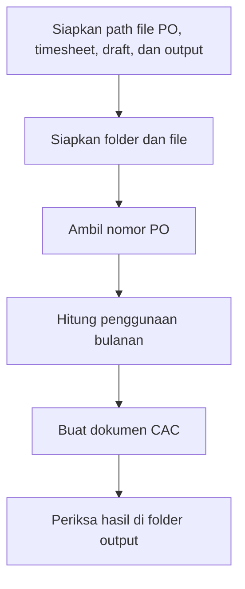

# Otomasi Dokumen CAC dengan UiPath

Repository ini berisi workflow UiPath untuk membantu menyiapkan dokumen CAC dari data PO, timesheet, dan draft yang disediakan. Proses utama dirangkai di `Main.xaml`.

## Alur kerja

Urutan tersebut mengikuti workflow yang dipanggil dari `Main.xaml`. Dokumen input dan hasil tetap perlu diperiksa oleh pengguna.

## Teknologi

- UiPath Studio, target Windows.
- Dependensi aktivitas UiPath tercantum di `project.json` (project dibuat dengan UiPath Studio 22.10.3).
- Workflow menggunakan ekspresi Visual Basic.

## Menjalankan proyek

1. Buka `project.json` atau `Main.xaml` di UiPath Studio yang kompatibel.
2. Pulihkan dependensi proyek melalui UiPath Studio.
3. Siapkan salinan input yang sudah disamarkan: file PO, timesheet, draft CAC, dan folder output.
4. Atur argumen path pada workflow utama sesuai lokasi file lokal.
5. Jalankan workflow dan periksa dokumen hasil sebelum digunakan.

Nama argumen path yang dipakai workflow utama adalah `pathPoFile`, `pathTimesheet`, `pathDraftCac`, dan `pathOutput`.

## Catatan keamanan dan batasan

- Jangan memasukkan dokumen perusahaan, data karyawan, atau informasi pribadi ke repository publik. Gunakan contoh yang sudah disamarkan.
- Workflow utama memiliki blok penanganan exception yang belum mencatat detail error. Periksa log UiPath dan validasi hasil secara manual saat terjadi kegagalan.
- Kesesuaian dokumen hasil bergantung pada format dan struktur file input.
